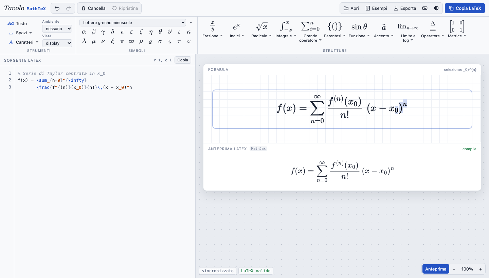

# Tavolo MathTeX

[](#stack-tecnologico)
[](#funzionalità)
[](#licenza)



---

## Documentazione

Tavolo MathTeX è un **editor visuale di equazioni matematiche in LaTeX** che funziona interamente nel browser, senza installare nulla e senza backend. È il fratello di [Tavolo TikZ](https://github.com/giozoc/tavolo-tikz): stessa interfaccia a due ante, stessa attenzione al codice sorgente, applicate alle formule.

- **Contenuto del repository**:

  * Editor del sorgente LaTeX con evidenziazione, numeri di riga, suggerimenti dei comandi e segnalazione degli errori
  * Formula modificabile con il cursore, basata su [MathLive](https://cortexjs.io/mathlive/)
  * Sincronizzazione bidirezionale che **riscrive solo la parte cambiata** del sorgente
  * Barra multifunzione con strutture e simboli organizzati come nell'editor di equazioni di Word
  * Anteprima e verifica indipendente con MathJax
  * Esempi `.tex` compilabili con pdfLaTeX e test automatici nel browser

---

## Panoramica del Progetto

Scrivere una formula in LaTeX significa ricordare comandi, contare graffe e ricompilare. Tavolo MathTeX tiene **il codice a sinistra e la formula a destra, sincronizzati nei due sensi**:

- ogni modifica al codice si vede **subito** nella formula
- nella formula si clicca, si sposta il cursore nel numeratore, si seleziona un'espressione, si sostituisce un esponente o si inserisce una struttura dai menu: il codice LaTeX si aggiorna da solo
- la modifica visuale **non riscrive l'intera formula**: commenti, a capo, spazi e grafia del sorgente restano dove sono, e cambia solo il tratto toccato
- il risultato è **LaTeX standard** (amsmath e amssymb), pronto da incollare in articoli, tesi e appunti

> La formula a destra è disegnata da MathLive; l'anteprima sotto è di MathJax e fa da controllo: se compila lì, il codice è LaTeX valido. Per la versione finale conviene comunque compilare con pdfLaTeX.

---

## Funzionalità

**Barra multifunzione** (organizzazione alla Word, aspetto Tavolo)
- *Strumenti*: testo normale, spazi matematici, stili di carattere (`\mathbb`, `\mathcal`, `\mathfrak`, `\mathrm`, `\mathbf`, …), delimitatori della formula (`$…$`, `\[…\]`, `equation`, `align*`, …), vista display o in linea
- *Simboli*: lettere greche, operatori, relazioni, frecce, logica, insiemi e simboli vari, con galleria completa
- *Strutture*, ciascuna con una galleria di modelli disegnati:
  frazioni (in pila, lineari, continue, annidate) · indici (apici, pedici, a sinistra) · radicali · integrali (definiti, multipli, di linea, differenziali) · grandi operatori (sommatorie, produttorie, unioni, intersezioni) · parentesi (fisse, adattive, con separatore, binomiali, casi) · funzioni (trigonometriche, logaritmi, derivate) · accenti e annotazioni (vettori, cappelli, graffe, `\overset`, `\boxed`) · limiti · operatori con frecce estensibili · matrici (vuote, con parentesi, determinanti, sistemi, array e **matrice di dimensione a scelta**)
- ogni modello ha caselle da riempire: si passa dall'una all'altra con **Tab**; se c'è una selezione, la struttura la avvolge
- i menu agiscono dove si trova il cursore: nella formula, oppure **direttamente nel codice** se l'ultimo pannello usato è il sorgente

**Sorgente sempre disponibile**
- copia del LaTeX con un pulsante (anche come `$…$`, `\[…\]` o `equation`) e con **Ctrl+Maiusc+C**
- esportazione come documento `.tex` con i pacchetti necessari, **SVG**, **PNG** e **MathML**
- apertura di un file `.tex`: se contiene più formule si sceglie quale modificare
- annulla e ripeti con **una sola cronologia** per codice e formula; cancella e ripristina

**Errori senza blocchi**
- graffe non chiuse, `\begin`/`\end` e `\left`/`\right` spaiati, doppi esponenti: sottolineati nel codice, con la riga segnata
- comandi sconosciuti a LaTeX o non modificabili nella formula: segnalati, ma il resto continua a funzionare
- clic su un messaggio per andare al punto del sorgente

---

## Stack Tecnologico

- **Linguaggio**: JavaScript (ES2020), senza framework né passaggi di compilazione, come Tavolo TikZ
- **Formula modificabile**: [MathLive](https://cortexjs.io/mathlive/) 0.111 (licenza MIT, caricato da CDN)
- **Anteprima e verifica LaTeX**: [MathJax 3](https://www.mathjax.org/) (caricato da CDN)
- **Interfaccia**: HTML e CSS ripresi da Tavolo TikZ, con temi chiaro e scuro
- **Pubblicazione**: sito statico, adatto a GitHub Pages

### Perché MathLive

Un editor di formule con cursore, caselle e selezione strutturale è un progetto a sé. MathLive lo offre già, è mantenuto, funziona nel browser senza dipendenze e capisce i modelli con caselle (`\frac{#0}{#?}`). Tavolo MathTeX lo usa come **rappresentazione modificabile**, ma non come fonte di verità: la fonte di verità resta il testo del sorgente. Le alternative valutate (scrivere un editor strutturale da zero, oppure un `contenteditable` sopra l'output di MathJax) avrebbero richiesto un parser e un modello della formula propri, che è proprio ciò che si voleva evitare.

---

## Architettura

Tre livelli distinti, sempre separati:

1. **Sorgente** – il testo dell'utente, unica fonte di verità. Non viene mai riscritto per intero se non è indispensabile
2. **Rappresentazione modificabile** – MathLive riceve il *corpo* della formula (i delimitatori come `\begin{align*}` restano nel sorgente e non vengono toccati)
3. **Risultato renderizzato** – MathLive a schermo, MathJax come anteprima e controllo indipendente

La sincronizzazione è a senso unico per evento, così non nascono cicli:

- **codice → formula**: a ogni battitura il corpo viene passato a MathLive senza generare eventi
- **formula → codice** (`js/03-sync.js`):
  1. si confrontano le serializzazioni di MathLive prima e dopo la modifica, per isolare i token cambiati
  2. i token del sorgente (senza spazi e commenti) vengono allineati a quelli di MathLive con una LCS: così si sa a quale tratto del sorgente corrisponde la modifica, anche se la grafia è diversa (`\frac12` e `\frac{1}{2}`, `x^{2}` e `x^2`)
  3. si sostituisce solo quel tratto e **si verifica**: il nuovo sorgente, riletto da MathLive, deve dare esattamente la formula mostrata e non deve avere più errori di sintassi di prima. Se la verifica fallisce si prova un tratto più ampio (il gruppo che contiene la modifica) e, solo come ultima risorsa, si riscrive il corpo
  4. se MathLive produce uno stato che il suo stesso LaTeX non riproduce (per esempio due esponenti sullo stesso simbolo dopo una cancellazione), nel sorgente si scrive la forma valida e la formula viene riallineata, con il cursore nello stesso punto

Il codice prodotto da MathLive passa da una piccola pulizia perché resti LaTeX standard: `\middle{|}` diventa `\middle|`, `^{\doubleprime}` diventa `''`, `\frac12` diventa `\frac{1}{2}`, e le scorciatoie di MathLive che userebbero comandi suoi (`\differentialD`, `\exponentialE`, …) sono sostituite con quelli standard.

Le caselle vuote (`\placeholder{}` in MathLive) non finiscono mai nel sorgente (`js/02-latex.js`): un argomento vuoto si scrive `{}` (`\frac{}{}`, `x^{}`), una cella vuota di matrice o sistema `{}` e un indice vuoto `[]` (`\sqrt[]{}`), tutto LaTeX valido. Così le righe vuote di un sistema non spariscono alla rilettura e, quando la formula viene ricaricata dal codice, ogni argomento vuoto torna a mostrare la sua casella.

---

## Struttura del Repository

```text
tavolo-latex/
├── index.html              # pagina principale
├── css/
│   └── style.css           # stile e temi, ripresi da Tavolo TikZ
├── js/
│   ├── 01-core.js          # utilità, modali, tema, divisore, rendering MathJax
│   ├── 02-latex.js         # token, delimitatori, evidenziazione, controlli, modelli
│   ├── 03-sync.js          # riscrittura minima del sorgente dalla formula
│   ├── 04-editor.js        # editor del codice, cronologia, suggerimenti
│   ├── 05-mathfield.js     # formula modificabile (MathLive)
│   ├── 06-catalog.js       # strutture e simboli della barra multifunzione
│   ├── 07-ribbon.js        # barra multifunzione e gallerie
│   ├── 08-preview.js       # verifica e anteprima MathJax, messaggi
│   └── 09-panel.js         # esportazione, esempi, file, scorciatoie, avvio
├── esempi/
│   └── formule.tex         # gli esempi dell'editor, compilabili con pdfLaTeX
├── tests/                  # prove automatiche nel browser (Playwright)
├── docs/
│   └── anteprima.png       # immagine del README
└── LICENSE
```

---

## Avvio

**In locale**:

1. Clona il repository ed entra nella cartella.
2. Avvia un server statico e apri il browser su `http://localhost:8000`:

```bash
   python3 -m http.server 8000
```

   Non servono altri passaggi: i file si caricano così come sono (MathLive e MathJax arrivano dal CDN jsDelivr). Funziona anche aprendo direttamente `index.html`.

3. Per pubblicarlo su GitHub Pages basta attivare Pages sul ramo principale, cartella radice.

4. Per confrontare con LaTeX, compila gli esempi:

```bash
   cd esempi
   pdflatex formule.tex
```

---

## Prove automatiche

Le prove usano Playwright con Chromium (`pip install playwright && playwright install chromium`) e si eseguono dalla cartella `tests`:

| Prova | Cosa controlla |
|---|---|
| `test_ui.py` | scenari reali con mouse e tastiera: frazione da menu e Tab tra le caselle, radice sulla selezione, esponente sostituito, modifiche che lasciano intatti commenti e a capo, annulla e ripeti, inserimento nel codice, errori, `align*`, matrice personalizzata, matrici a una colonna e sistemi (le righe vuote restano), caselle per gli argomenti vuoti scritti nel codice, delimitatori, esportazione, apertura di file con più formule |
| `test_menus.py` | ogni voce dei menu (oltre 400) inserita in una formula vuota: deve dare LaTeX che MathJax compila e MathLive rilegge senza errori |
| `test_fuzz.py` | migliaia di modifiche casuali sulla formula, su formule semplici, annidate, con commenti e delimitatori: il sorgente deve sempre corrispondere alla formula, restare valido e cambiare solo dove serve |
| `test_pdflatex.py` | compila con pdfLaTeX tutto ciò che l'editor produce (menu, esempi, formule modificate a caso) |

Ultimo risultato: 37/39 scenari superati (i due rimanenti, radice e stile di carattere applicati a una selezione fatta con Ctrl+A, dipendono dalla selezione nel browser di prova); 420 voci di menu valide; su circa 1400 modifiche casuali il 98% riscrive solo il tratto cambiato (in media il 3,3% del testo), con zero incoerenze tra codice e formula e zero sorgenti resi non validi; 446 formule su 446 compilano con pdfLaTeX.

Senza rete, la variabile `LOCAL_LIBS` può puntare a una cartella `node_modules` con `mathlive` e `mathjax`.

---

## Scorciatoie

| Tasto | Azione |
|---|---|
| Ctrl+Z / Ctrl+Y | Annulla / Ripeti (codice e formula condividono la cronologia) |
| Ctrl+Maiusc+C | Copia il codice LaTeX |
| Ctrl+S | Scarica la formula come documento `.tex` |
| Alt+F · Alt+E · Alt+R · Alt+I · Alt+S | Frazione · Indici · Radicale · Integrale · Grande operatore |
| Alt+P · Alt+U · Alt+A · Alt+L · Alt+O · Alt+M | Parentesi · Funzione · Accento · Limite · Operatore · Matrice |
| Alt+T · Alt+G | Testo normale · Tutti i simboli |
| Tab / Maiusc+Tab | Casella successiva / precedente nella formula |
| `/` `^` `_` | Frazione, apice, pedice mentre si scrive nella formula |
| `\` + comando + Invio | Scrive un comando LaTeX direttamente nella formula |
| F1 | Elenco delle scorciatoie |

---

## Limiti Noti

- La formula a destra è una sola: un file con più formule si apre scegliendo quale modificare.
- Negli ambienti `align*` e `gather*` la formula viene mostrata come un unico `aligned`/`gathered`; `\label` e `\nonumber` restano nel sorgente ma non si modificano visivamente.
- I comandi che MathLive non conosce (macro personali, pacchetti particolari) restano nel sorgente e vengono segnalati, ma nella formula appaiono come testo da non modificare.
- Alcune grafie compatte di MathLive (`x^2` al posto di `x^{2}`) compaiono nelle parti scritte dalla formula; il resto del sorgente mantiene la grafia originale.

---

## Ringraziamenti

Interfaccia e impostazione tecnica riprese da [Tavolo TikZ](https://github.com/giozoc/tavolo-tikz). Modifica delle formule con [MathLive](https://github.com/arnog/mathlive) di Arno Gourdol (MIT); anteprima con [MathJax](https://www.mathjax.org/).

---

## Licenza

Questo progetto è distribuito sotto licenza **GNU GPL v3.0**, come Tavolo TikZ.
